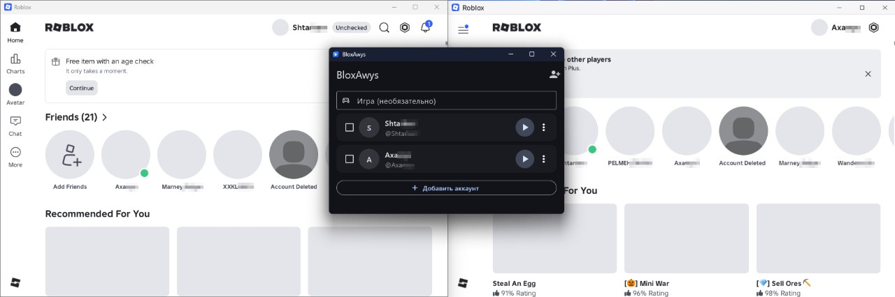
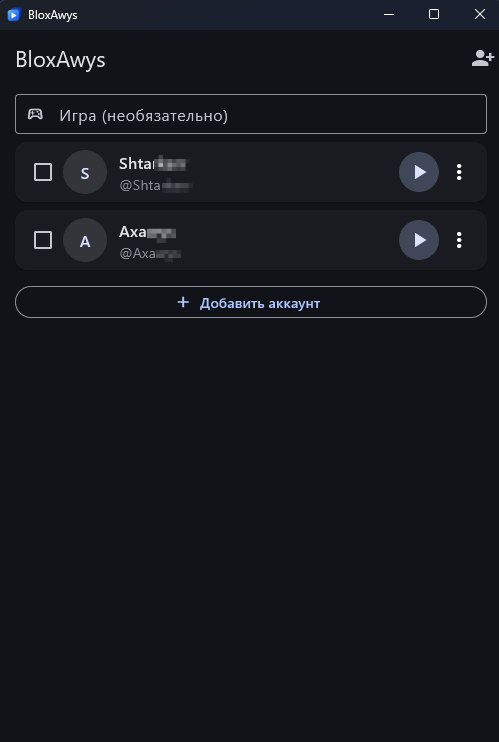

<div align="center">


# BloxAwys

Runs several Roblox windows at once, each signed in to its own account.

[Русский](README.md) · **English**

[](https://github.com/Axawys/BloxAwys/releases/latest)


[](LICENSE)

</div>

## Screenshots

<div align="center">

<br><br>

</div>

## Features

- Keep several Roblox windows open on different accounts. A new window doesn't close the previous ones.
- Accounts are saved in a list. You sign in once, then start Roblox with the ▶ button, no password needed.
- Tick several accounts and launch them in one go.
- Paste a game link or Place ID and the windows open straight in that game. Without a link you get the Roblox home screen.
- You type your login and password on roblox.com in a built-in window; the client doesn't see or store them.
- Sessions are kept only on your computer, encrypted.
- If Roblox resets a sign-in, the account gets a "Sign in again" button.
- Works with Bloxstrap and Fishstrap: it finds the Roblox they installed and starts it directly.

The app interface is in Russian for now.

## Installation

1. Download `setup.exe` from the [latest release](https://github.com/Axawys/BloxAwys/releases/latest).
2. Run the installer. If you see "Windows protected your PC", click "More info", then "Run anyway". Windows shows this because the app doesn't have a paid code signature.
3. Open BloxAwys, click "Войти и запустить Roblox" (Sign in and launch Roblox) and sign in.

Add your other accounts the same way. After that, pick accounts in the list and launch them.

BloxAwys has to stay open while Roblox windows are open. If you close it, the next Roblox window will close the previous ones.

## Security

The client only talks to Roblox servers and has no servers of its own. Sessions are encrypted with Windows DPAPI and tied to your Windows account, so they can't be decrypted on another computer or by another user. The code is open and lives in this repository. Each release page has a VirusTotal report and the installer checksum.

A session gives full access to the account, so don't share the files in `%APPDATA%\com.axawys` with anyone.

## FAQ

<details>
<summary>Roblox windows still close each other</summary>

Most likely Roblox was already open when BloxAwys started; the client shows a warning in that case. Close all Roblox windows, restart BloxAwys and launch your accounts from it.
</details>

<details>
<summary>An account says the session has expired</summary>

This happens if you click "Log out" inside Roblox, change the password, or end sessions in the account settings. Click "Sign in again" and sign in once more.
</details>

<details>
<summary>"Roblox is not installed"</summary>

Install Roblox from [roblox.com](https://www.roblox.com/download) and click "Check". A regular install, Bloxstrap and Fishstrap all work.
</details>

## Technical details

<details>
<summary>How it works</summary>

Sign-in happens in an embedded WebView2 showing `roblox.com/login`. Each sign-in gets a temporary profile. Once you're signed in, the client takes the `.ROBLOSECURITY` cookie and deletes the profile. It doesn't log out, because that would invalidate the cookie.

Accounts are stored with `flutter_secure_storage` (DPAPI) in `%APPDATA%\com.axawys\bloxawys\flutter_secure_storage.dat`.

To launch, the client exchanges the cookie for a one-time ticket (`auth.roblox.com/v1/authentication-ticket`) and starts `RobloxPlayerBeta.exe` with it directly. It doesn't use the `roblox-player:` protocol, so Bloxstrap can't intercept the launch. If Roblox sends back a refreshed cookie, the client saves it.

To keep windows from closing each other, the client creates `ROBLOX_singletonMutex` and `ROBLOX_singletonEvent` on startup and holds them while it's open (`lib/services/multi_instance.dart`).

When several accounts are launched, there's a 2-second pause between them.

</details>

<details>
<summary>Building on Windows</summary>

1. Install [Flutter](https://docs.flutter.dev/get-started/install/windows/desktop).
2. Install Visual Studio 2022 with the "Desktop development with C++" workload.
3. Install the NuGet CLI, which the WebView plugin needs: `winget install Microsoft.NuGet`, then restart the terminal.
4. Turn on Windows Developer Mode (Settings → System → For developers). Without it Flutter can't create symlinks for plugins.
5. In the project folder:
   ```
   flutter pub get
   flutter run -d windows
   ```
   For a release build run `flutter build windows`; the files end up in `build\windows\x64\runner\Release\`.

To run the build on another computer, put `msvcp140.dll`, `vcruntime140.dll` and `vcruntime140_1.dll` next to `bloxawys.exe`, or install the Visual C++ Redistributable there. WebView2 Runtime usually comes with Windows 10 and 11.

</details>

<details>
<summary>Previewing the UI on Linux</summary>

```
./run_linux.sh
```

The script builds a demo version (`lib/main_demo.dart`) and opens a 520×760 window, same as on Windows. On Hyprland the window opens floating. The demo has three test accounts kept in memory, and "launching" only shows a spinner. Sign-in and launching Roblox don't work on Linux, since there's no WebView2 or Roblox there. The theme is built as for Windows and uses Segoe UI; if that font isn't installed, the system font is used.

`./run_linux.sh --real` runs the regular version instead of the demo.

</details>

<details>
<summary>Project structure</summary>

```
lib/
├── main.dart                  entry point
├── main_demo.dart             demo mode for UI checks
├── app_controller.dart        app state: accounts, launching
├── models/account.dart        saved account
├── services/
│   ├── account_store.dart     encrypted storage
│   ├── roblox_api.dart        Roblox API: user, avatars, ticket
│   ├── roblox_launcher.dart   finding and launching RobloxPlayerBeta.exe
│   └── multi_instance.dart    multiple Roblox windows
└── ui/
    ├── home_page.dart         main window
    └── login_page.dart        sign-in window (WebView2)
```

</details>

## License

[GNU GPL v3](LICENSE). You can use, modify and share the code, but modified versions have to be published as open source under GPLv3 too.

<sub>BloxAwys is not affiliated with Roblox Corporation. Roblox is a trademark of Roblox Corporation.</sub>
