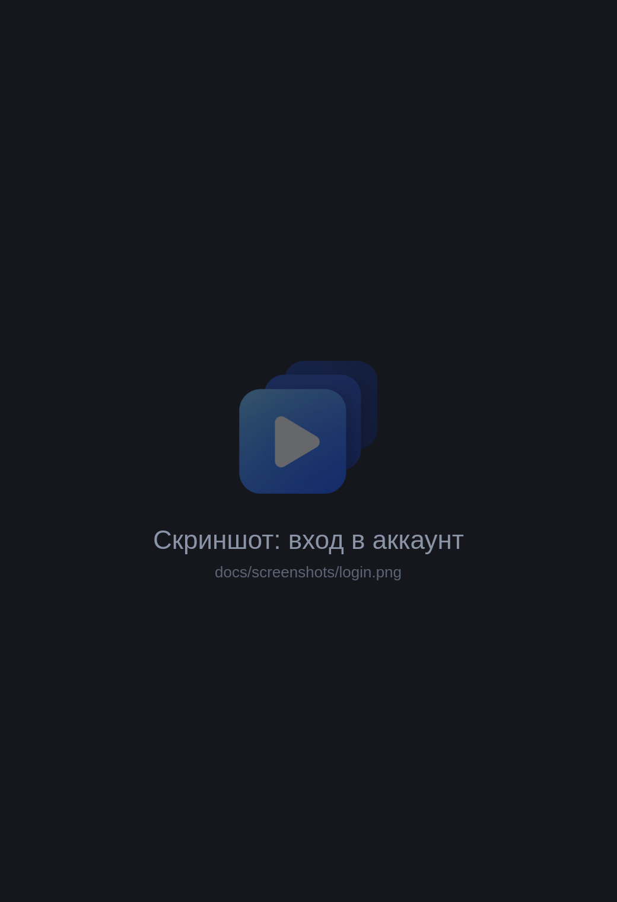

<div align="center">


# BloxAwys

**Несколько аккаунтов Roblox — несколько окон, запуск в один клик.**

**Русский** · [English](README.en.md)

[](https://github.com/Axawys/BloxAwys/releases/latest)


[](LICENSE)

</div>

---

## Скриншоты

<div align="center">

&nbsp;&nbsp;

<br><br>

</div>

## Возможности

- 🪟 **Несколько окон Roblox одновременно.** Каждое окно — под своим аккаунтом, новые окна не закрывают старые.
- 👥 **Все аккаунты в одном списке.** Входите один раз, дальше Roblox запускается кнопкой ▶ без ввода пароля.
- 🚀 **Пакетный запуск.** Отметьте нужные аккаунты галочками и запустите их все разом.
- 🎮 **Сразу в нужную игру.** Вставьте ссылку на игру или Place ID — все окна откроются в ней. Без ссылки откроется главный экран Roblox.
- 🔐 **Вход через официальный сайт.** Логин и пароль вводятся на roblox.com во встроенном окне. Клиент их не видит и не хранит.
- 🛡️ **Данные зашифрованы.** Сессии хранятся только на вашем компьютере в зашифрованном виде.
- 🔔 **Предупреждает об истёкшей сессии.** Если Roblox сбросил вход, у аккаунта появится «Войти заново».
- 🧩 **Работает рядом с Bloxstrap и Fishstrap.** Находит установленный ими Roblox и запускает его напрямую.

## Установка

1. Скачайте `setup.exe` со страницы [последнего релиза](https://github.com/Axawys/BloxAwys/releases/latest).
2. Запустите установщик.
   Если Windows покажет окно «Windows защитила ваш компьютер», нажмите **«Подробнее» → «Выполнить в любом случае»**. Окно появляется, потому что у программы нет платной цифровой подписи.
3. Откройте BloxAwys, нажмите **«Войти и запустить Roblox»** и войдите в аккаунт.

Повторите вход для остальных аккаунтов. Дальше выбирайте аккаунты в списке и запускайте.

> [!IMPORTANT]
> Не закрывайте BloxAwys, пока открыты окна Roblox. Без него следующее окно Roblox закроет предыдущие.

## Безопасность

- Клиент обращается только к серверам Roblox. Своих серверов, аналитики и рекламы нет.
- Сессии аккаунтов зашифрованы средствами Windows (DPAPI) и привязаны к вашей учётной записи Windows: на другом компьютере или под другим пользователем их не расшифровать.
- Исходный код открыт — в этом репозитории. Отчёт VirusTotal и контрольная сумма установщика есть на странице каждого релиза.

> [!WARNING]
> Сессия аккаунта даёт полный доступ к нему. Никому не передавайте файлы BloxAwys из папки `%APPDATA%\com.axawys`.

## Частые вопросы

<details>
<summary><b>Окна Roblox всё равно закрывают друг друга</b></summary>

Скорее всего, Roblox был открыт до запуска BloxAwys — клиент покажет об этом предупреждение. Закройте все окна Roblox, перезапустите BloxAwys и запускайте аккаунты из него.
</details>

<details>
<summary><b>У аккаунта написано «Сессия истекла»</b></summary>

Так бывает, если нажать «Выйти» внутри Roblox, сменить пароль или завершить сеансы в настройках аккаунта. Нажмите «Войти заново» и войдите ещё раз.
</details>

<details>
<summary><b>«Roblox не установлен»</b></summary>

Установите Roblox с [roblox.com](https://www.roblox.com/download) и нажмите «Проверить». Поддерживаются обычная установка, Bloxstrap и Fishstrap.
</details>

---

## Техническая информация

<details>
<summary><b>Как это работает</b></summary>

- **Вход.** Окно входа — встроенный WebView2 с `roblox.com/login`, у каждого входа свой временный профиль. После входа клиент забирает cookie `.ROBLOSECURITY`, а профиль удаляет. Из аккаунта при этом не выходит: выход сделал бы cookie недействительной.
- **Хранение.** Аккаунты хранятся через `flutter_secure_storage` (DPAPI) в `%APPDATA%\com.axawys\bloxawys\flutter_secure_storage.dat`.
- **Запуск.** По cookie запрашивается одноразовый тикет (`auth.roblox.com/v1/authentication-ticket`). С ним напрямую запускается `RobloxPlayerBeta.exe`, протокол `roblox-player:` не используется, чтобы его не перехватил Bloxstrap. Если Roblox обновил cookie в ответе, клиент сохраняет новую.
- **Несколько окон.** При старте клиент создаёт `ROBLOX_singletonMutex` и `ROBLOX_singletonEvent` и держит их, пока открыт (`lib/services/multi_instance.dart`).
- **Пакетный запуск.** Аккаунты запускаются по очереди с паузой 2 секунды, чтобы окна не мешали друг другу.

</details>

<details>
<summary><b>Сборка на Windows</b></summary>

1. Установить [Flutter](https://docs.flutter.dev/get-started/install/windows/desktop).
2. Установить Visual Studio 2022 с нагрузкой **«Разработка классических приложений на C++»**.
3. Установить NuGet CLI, он нужен плагину WebView: `winget install Microsoft.NuGet`, затем перезапустить терминал.
4. Включить **режим разработчика** Windows (Параметры → Система → Для разработчиков). Без него Flutter не может создавать симлинки для плагинов.
5. В папке проекта:
   ```
   flutter pub get
   flutter run -d windows
   ```
   Релизная сборка: `flutter build windows`, результат — в `build\windows\x64\runner\Release\`.

Для запуска на чужом компьютере рядом с `bloxawys.exe` нужны `msvcp140.dll`, `vcruntime140.dll` и `vcruntime140_1.dll` (или установленный Visual C++ Redistributable). WebView2 Runtime в Windows 10/11 обычно уже есть.

</details>

<details>
<summary><b>Проверка интерфейса на Linux</b></summary>

```
./run_linux.sh
```

Скрипт собирает демо-версию (`lib/main_demo.dart`) и открывает окно 520×760, как на Windows; в Hyprland — плавающим. В демо три тестовых аккаунта в памяти, «запуск» только показывает индикатор. Вход и запуск Roblox на Linux не работают: нет WebView2 и Roblox. Тема собирается для Windows и использует шрифт Segoe UI, если он не установлен, будет системный шрифт.

`./run_linux.sh --real` запускает обычную версию вместо демо.

</details>

<details>
<summary><b>Структура проекта</b></summary>

```
lib/
├── main.dart                  точка входа
├── main_demo.dart             демо-режим для проверки интерфейса
├── app_controller.dart        состояние приложения: аккаунты, запуск
├── models/account.dart        сохранённый аккаунт
├── services/
│   ├── account_store.dart     зашифрованное хранилище
│   ├── roblox_api.dart        API Roblox: пользователь, аватары, тикет
│   ├── roblox_launcher.dart   поиск и запуск RobloxPlayerBeta.exe
│   └── multi_instance.dart    несколько окон Roblox
└── ui/
    ├── home_page.dart         главное окно
    └── login_page.dart        окно входа (WebView2)
```

</details>

## Лицензия

[GNU GPL v3](LICENSE). Код можно свободно использовать, изменять и распространять, но изменённые версии тоже должны распространяться с открытым кодом под GPLv3.

---

<div align="center">
<sub>BloxAwys не связан с Roblox Corporation. Roblox — товарный знак Roblox Corporation.</sub>
</div>
